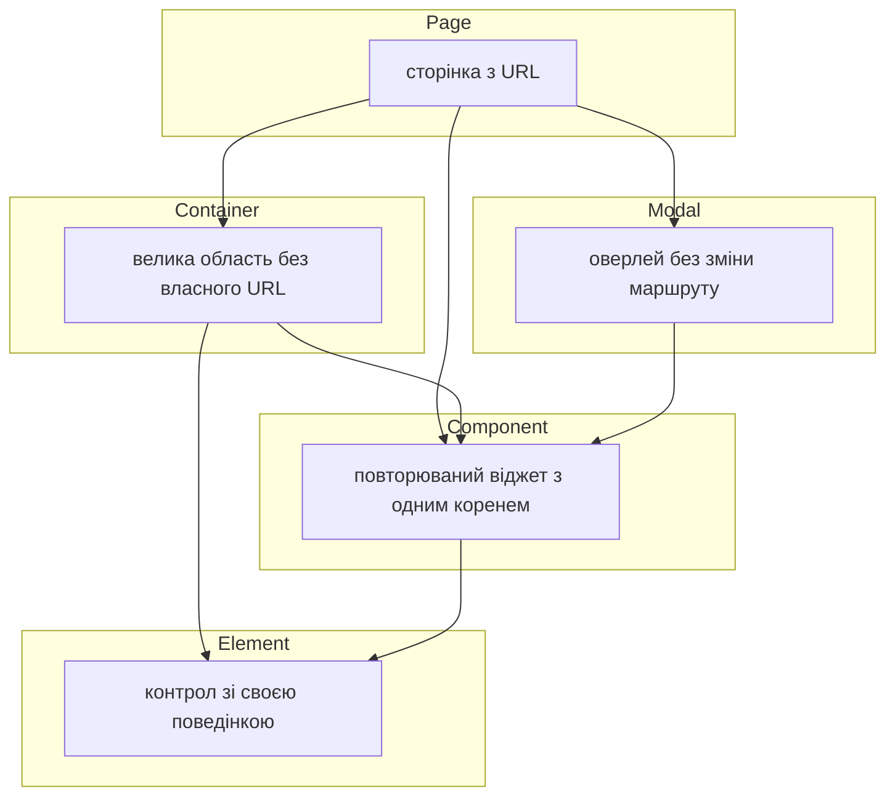
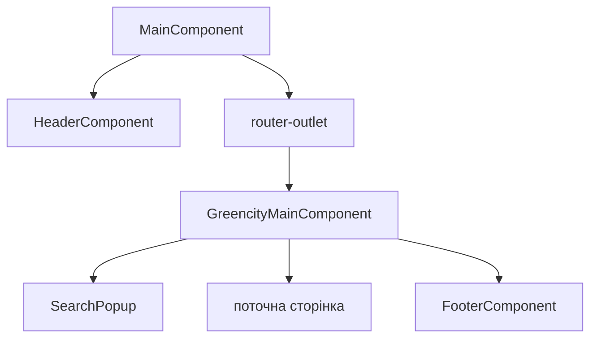
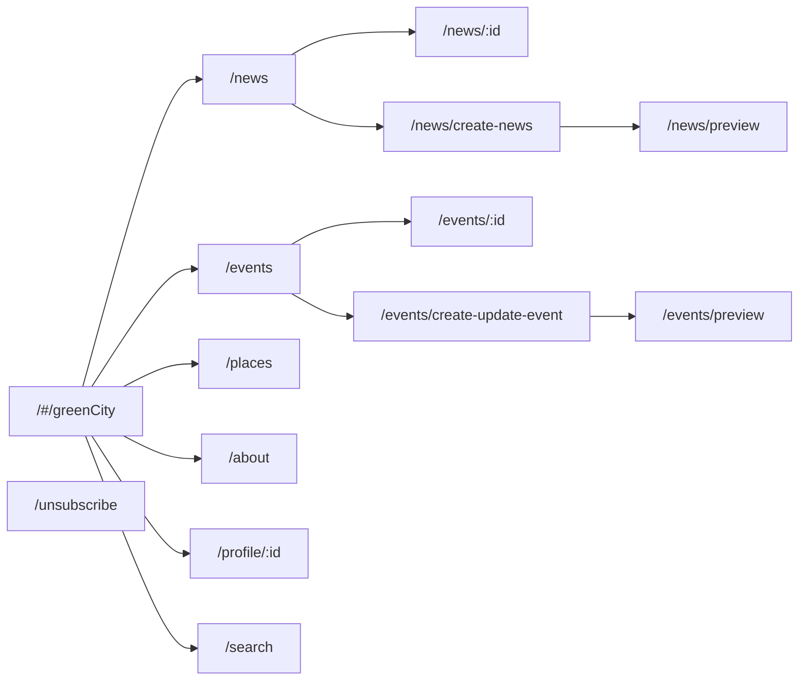

# Архітектура UI Page Object для GreenCity

Область тестів — модуль [GreenCity](https://www.greencity.cx.ua/#/greenCity). Джерело структури екранів — гілка `dev` репозиторію [GreenCityClient](https://github.com/ita-social-projects/GreenCityClient). Цей документ фіксує шари Page Object і склад кожного екрана. Поля, методи й UML — наступний крок.

## Системи

| Роль | Репозиторій | Що з нього беремо |
| --- | --- | --- |
| UI | [GreenCityClient](https://github.com/ita-social-projects/GreenCityClient) | маршрути, екрани, віджети, модалки |
| API основних функцій | [GreenCity](https://github.com/ita-social-projects/GreenCity) | новини, події, місця, звички, коментарі |
| API користувача | [GreenCityUser](https://github.com/ita-social-projects/GreenCityUser) | реєстрація, сесія, профіль, друзі, досягнення |

Хеш-маршрути UI мають префікс `#/greenCity`.

## Межі

У фреймворк входить усе, що користувач робить у модулі GreenCity: головна, еконовини, події, мапа, про нас, профіль і звички, друзі, пошук, збережене, авторизація з хедера.

Поза фреймворком:

- модуль UBS (`#/ubs`, замовлення, UBS-admin). Посилання на UBS є в хедері й футері, а під час реєстрації з UBS форма може показувати інші поля. Окремих page object для UBS немає, тести з GreenCity за цим посиланням не йдуть;
- чат (`src/app/chat`);
- Telegram;
- зовнішня адмінка (`management`) і зовнішні посилання хедера UBS (правила сортування, екокрамниця);
- маршрут `db-display`.

## Шари

Один Angular-компонент не дорівнює одному page object. У клієнті сотні дрібних компонентів. У тестах лишаємо ті одиниці, з якими сценарій реально взаємодіє.



| Шар | Коли це він | Базовий клас | Пакет |
| --- | --- | --- | --- |
| Page | Є власний URL. Вміє відкритись і перевірити, що екран той | `GreenCityPage` або `BasePage` | `ui.page` |
| Container | Велика область сторінки: фільтри разом зі списком, колонка профілю, форма з секцій. Власного URL немає | `BaseComponent` | `ui.container` |
| Component | Картка, пункт списку, фільтр тегів, хедер, футер. Один кореневий елемент, часто повторюється | `BaseComponent` | `ui.component` |
| Modal | Оверлей поверх поточної сторінки. Маршрут не змінюється | `BaseModal` | `ui.modal` |
| Element | Поле, дропдаун, перемикач мови, вибір тегів — якщо в нього є поведінка, а не лише `click` | `BaseElement` | `ui.elements` |

Правила збирання:

- Сторінка відкриває модалку і повертає її об'єкт. Модалка після успішної дії повертає сторінку, на яку потрапляє користувач.
- Спільні віджети (коментарі, картка новини, фільтр тегів, блок «Збережене») живуть в одному класі й підключаються на кілька сторінок.
- Стан екрана без нового URL — це режим сторінки, а не нова сторінка. Так зроблено для прев'ю новини й події та для закладки «Збережене».
- Дрібні Angular-компоненти (`remaining-count`, `change-view-button`, `stat-row`, `rating-display`, `google-btn`, `spinner`, `input-error`) не стають окремими page object. Їхні дії — методи батька або `Element`.

## Оболонка

`MainComponent` тримає хедер і `<router-outlet>`. `GreencityMainComponent` тримає пошуковий попап, вкладений outlet і футер.



`BasePage` уже створює `HeaderComponent` (`//app-header`) і `FooterComponent` (`//footer`). Футер є лише всередині GreenCity. Сторінка підтвердження нового пароля (`#/auth/restore`) лежить під `MainComponent`, але поза `GreencityMainComponent`, тому футера GreenCity на ній немає.

Тому:

- `GreenCityPage extends BasePage` — сторінки `#/greenCity/**`. Хедер, футер, пошук.
- `ConfirmRestorePasswordPage extends BasePage` — лише хедер. Футер не ініціалізувати.

Навігація хедера в режимі GreenCity:

| Пункт | Маршрут |
| --- | --- |
| Eco news | `#/greenCity/news` |
| Events | `#/greenCity/events` |
| Map | `#/greenCity/places` |
| About us | `#/greenCity/about` |
| My habits | `#/greenCity/profile` |
| UBS | `#/ubs` — пункт видимий, page object немає |

Праворуч у хедері: закладки, сповіщення, пошук, мова (Uk / En), меню користувача або Sign in / Sign up, бургер. Меню користувача і бургер — стани `HeaderComponent`, не окремі модалки. Закладка веде на `#/greenCity/news?isBookmark=true`.

Футер повторює ті самі розділи і додає соцмережі. Посилання UBS у футері теж не покриваємо сторінкою.

## Карта маршрутів



Профіль далі розгалужується:

| Маршрут | Page |
| --- | --- |
| `#/greenCity/profile/:id` | `ProfilePage` |
| `#/greenCity/profile/:id/edit` | `EditProfilePage` |
| `#/greenCity/profile/:id/notifications` | `NotificationsPage` |
| `#/greenCity/profile/:id/allhabits` | `AllHabitsPage` |
| `#/greenCity/profile/:id/allhabits/addhabit/:habitId` | `HabitFormPage` |
| `#/greenCity/profile/:id/allhabits/edithabit/:habitAssignId` | `HabitFormPage` |
| `#/greenCity/profile/:id/create-habit` | `CustomHabitPage` |
| `#/greenCity/profile/:id/allhabits/addhabit/:habitId/edit-habit` | `CustomHabitPage` |
| `#/greenCity/profile/:id/allhabits/edithabit/:habitAssignId/edit-habit` | `CustomHabitPage` |
| `#/greenCity/profile/:id/friends` | `FriendsPage`, вкладка All |
| `#/greenCity/profile/:id/friends/recommended` | `FriendsPage`, вкладка Recommended |
| `#/greenCity/profile/:id/friends/requests` | `FriendsPage`, вкладка Requests |
| `#/greenCity/profile/:id/friends/.../:userId` і сусідні маршрути друга | `FriendProfilePage` |

Авторизація поза модулем, але входить у фреймворк:

| Маршрут | Page |
| --- | --- |
| `#/auth/restore` | `ConfirmRestorePasswordPage` |

Sign in, Sign up і «забув пароль» маршруту не мають. Це види однієї `AuthModal`.

`#/greenCity/news/post-news-loader` — короткий перехід під час публікації. Окремої сторінки немає: `CreateEditNewsPage` чекає завершення переходу.

## Сторінки

### GreenCity

| Page | URL | З чого складається |
| --- | --- | --- |
| `HomePage` | `#/greenCity` | герой із кнопкою Start habit, блок статистики, стрічка еконовин, підписка |
| `AboutPage` | `#/greenCity/about` | текст і картки vision |
| `NewsListPage` | `#/greenCity/news` | пошук по стрічці, закладка, фільтр тегів, галерея або список, нескінченний скрол. Режим `isBookmark=true` показує вкладки збереженого |
| `NewsDetailPage` | `#/greenCity/news/:id` і `#/greenCity/news/preview` | теги, тіло новини, лайк, шеринг, віджет інших новин, коментарі. Прев'ю — той самий клас у режимі перегляду перед публікацією |
| `CreateEditNewsPage` | `#/greenCity/news/create-news` | форма створення й редагування. Query `id` вмикає редагування |
| `EventsListPage` | `#/greenCity/events` | пошук, закладка, фільтри, галерея або список карток, нескінченний скрол |
| `EventDetailsPage` | `#/greenCity/events/:id` і `#/greenCity/events/preview` | галерея, розклад, місце або посилання, опис, join / save / rate, коментарі. Прев'ю — режим того самого класу, з кнопкою Publish замість join |
| `EventEditorPage` | `#/greenCity/events/create-update-event` і `.../:id` | секції інформації та дат. Лише для авторизованого користувача |
| `PlacesPage` | `#/greenCity/places` | пошук місця, вибір локації, теги, додаткові фільтри, мапа, бічна панель списку і картка місця |
| `SearchResultsPage` | `#/greenCity/search` | повна видача пошуку. Попап показує лише перші результати й веде сюди |
| `UnsubscribePage` | `#/greenCity/unsubscribe` | підтвердження відписки від розсилки |

### Профіль і звички

| Page | З чого складається |
| --- | --- |
| `ProfilePage` | ліва колонка: шапка профілю, досягнення, друзі, еко-місця, to-do. Центр: дашборд звичок і активності. Праворуч: календар і картки активності |
| `EditProfilePage` | особисті дані, фото, соцмережі. Є захист від втрати незбережених змін |
| `NotificationsPage` | список сповіщень користувача. Дзвінок у хедері відкриває попап, а не цю сторінку |
| `AllHabitsPage` | фільтри, лічильник, галерея або список звичок, перехід до створення |
| `HabitFormPage` | взяття існуючої звички або редагування вже призначеної: тривалість, to-do, запрошення друзів, прогрес |
| `CustomHabitPage` | створення і редагування власної звички |
| `FriendsPage` | пошук, вкладки All / Recommended / Requests, список людей |
| `FriendProfilePage` | профіль іншої людини і дії дружби |

`ProfilePage` і `FriendProfilePage` — різні екрани. Другий не наслідує розмітку особистого дашборда.

### Авторизація

| Page | З чого складається |
| --- | --- |
| `ConfirmRestorePasswordPage` | форма нового пароля після переходу з листа. Маршрут `#/auth/restore` |

## Контейнери

Контейнер належить одній сторінці, якщо нижче не сказано інше.

| Container | Де живе | Що тримає |
| --- | --- | --- |
| `HomeHero` | `HomePage` | заголовок і Start habit |
| `HomeStats` | `HomePage` | підпис із кількістю користувачів і рядки статистики |
| `HomeEcoNews` | `HomePage` | прев'ю стрічки еконовин |
| `SubscribeForm` | `HomePage` | форма підписки на розсилку |
| `SavedTabs` | `NewsListPage`, `EventsListPage`, `PlacesPage` | заголовок Saved і вкладки розділів. З'являється при `isBookmark=true` |
| `NewsFilterBar` | `NewsListPage` | пошук стрічки, закладка, створення новини, фільтр тегів, перемикач вигляду |
| `EventFilterBar` | `EventsListPage` | пошук, час, локація, статус, тип, перемикач вигляду, створення події |
| `PlaceFilterBar` | `PlacesPage` | пошук назви, вибір локації, теги, more options, кнопка Add place |
| `PlaceListPanel` | `PlacesPage` | список місць у сайдбарі |
| `PlaceDetailsPanel` | `PlacesPage` | картка вибраного місця: фото, адреса, рейтинг, сайт |
| `MapCanvas` | `PlacesPage` | мапа і маркери. Окремий контейнер, бо клік по маркеру відкриває картку |
| `NewsContent` | `NewsDetailPage` | теги, заголовок, автор, лайк, зображення, текст, джерело, шеринг |
| `RelatedNews` | `NewsDetailPage` | віджет інших новин |
| `EventSummary` | `EventDetailsPage` | заголовок, дата, організатор, лайк, галерея, теги, учасники |
| `EventFacts` | `EventDetailsPage` | дата, локація або онлайн-посилання, відкритість, кнопки save / join / rate |
| `EventDescription` | `EventDetailsPage` | текст події |
| `CommentsContainer` | `NewsDetailPage`, `EventDetailsPage` | форма коментаря, список, відповіді, лайк, пагінація |
| `EventInformationForm` | `EventEditorPage` | назва, опис, теги, зображення |
| `EventDatesForm` | `EventEditorPage` | дата і час, онлайн або місце |
| `NewsEditorForm` | `CreateEditNewsPage` | заголовок, текст, теги, джерело, зображення, дії preview / publish |
| `ProfileHeader` | `ProfilePage` | ім'я, фото, прогрес, дії профілю |
| `ProfileDashboard` | `ProfilePage` | звички в роботі, новини й події користувача |
| `ProfileCalendar` | `ProfilePage` | місяць на десктопі, тиждень на вузькому екрані |
| `AchievementsBlock` | `ProfilePage` | короткий список досягнень, відкриває модалку |
| `FriendsPreview` | `ProfilePage` | кілька друзів і перехід до `FriendsPage` |
| `EcoPlacesBlock` | `ProfilePage` | місця користувача, якщо блок увімкнений у профілі |
| `TodoList` | `ProfilePage` | список справ, якщо блок увімкнений |
| `HabitFilterBar` | `AllHabitsPage` | набір фільтрів і скидання |
| `FriendTabs` | `FriendsPage` | пошук друзів і три вкладки |

## Компоненти

Спільні, їх підключають контейнери й сторінки:

| Component | Роль |
| --- | --- |
| `HeaderComponent` | уже є. Лого, пункти меню, мова, пошук, закладки, дзвінок, меню користувача, Sign in / Sign up, бургер |
| `FooterComponent` | уже є. Посилання розділів і соцмережі |
| `TagFilter` | мультивибір тегів на новинах, мапі та формах |
| `NewsCard` | картка новини в галереї й у списку, включно із закладкою |
| `EventCard` | картка події у списку подій |
| `HomeNewsCard` | картка в блоці еконовин на головній |
| `HabitCard` | картка звички в галереї й у списку |
| `FriendItem` | рядок людини у списку друзів, рекомендацій і запитів |
| `CommentItem` | коментар: текст, лайк, відповідь, редагування, видалення |
| `VisionCard` | картка на сторінці About |
| `SearchResultItem` | рядок результату в попапі й на сторінці пошуку |
| `NoDataBlock` | порожній стан списку |
| `UserAvatar` | фото користувача там, де воно клікабельне |

Перемикач вигляду галерея/список — метод сторінки списку, не окремий компонент.

## Модалки

Усі наслідують `BaseModal`: очікування появи кореня, закриття, перевірка, що оверлей зник.

| Modal | Хто відкриває | Види і зміст |
| --- | --- | --- |
| `AuthModal` | хедер, Sign in / Sign up, а також дії, що вимагають сесію | види `sign-in`, `sign-up`, `restore-password`. Усередині: Google-вхід, лист підтвердження пошти, розблокування акаунта, повідомлення про помилку. Окремі page для цих видів не потрібні |
| `SearchPopup` | іконка пошуку в хедері | поле, лічильник, до трьох новин, подій і місць, перехід на повну видачу, порожній стан |
| `NotificationsPopup` | дзвінок у хедері | короткі сповіщення. Повний список — `NotificationsPage` |
| `ConfirmDialog` | видалення новини, події, коментаря, вихід із форми з незбереженими змінами | заголовок, текст, підтвердження і скасування. Один клас на спільний `dialog-pop-up` / `warning-pop-up` |
| `EditPhotoModal` | редагування профілю | кроп фото профілю |
| `EditEventImageModal` | редактор події | кроп зображення події |
| `AddPlaceModal` | кнопка Add place на мапі | адреса, час роботи, теги. Стартує з попапа вибору часу |
| `AchievementsModal` | блок досягнень профілю | повний список досягнень |
| `CalendarHabitsPopup` | день календаря профілю | звички цього дня |
| `InviteFriendsModal` | форма звички | вибір друзів для запрошення |
| `FriendsListPopup` | профіль | розширений список друзів без переходу на `FriendsPage` |
| `EventCardModal` | картка події, якщо відкривається швидкий перегляд | стислий перегляд події зі списку |
| `RateEventModal` | кнопка Rate на завершеній події | оцінка події |
| `AddCityModal` | фільтр локації у списку подій | додавання міста у фільтр |
| `UserSettingsModal` | дії шапки профілю | налаштування видимості блоків профілю. Власного маршруту немає |

## Елементи

Має сенс виносити в `BaseElement` лише контрол, у якого є повторювана поведінка:

| Element | Поведінка |
| --- | --- |
| `LanguageSwitcher` | відкрити список і вибрати Uk або En |
| `TagSelect` | вибрати і зняти теги у фільтрі та у формі |
| `MultiSelectFilter` | мат-селект фільтрів подій і звичок: відкрити, вибрати кілька, закрити |
| `PlaceSearchField` | поле назви місця і підказки |
| `LocationAutocomplete` | поле вибору локації на мапі |
| `RichTextEditor` | текст новини і події |

Звичайні `input`, кнопки й посилання залишаються полями сторінки або контейнера.

## Пакети

Поточний каркас уже містить `Base`, `BasePage`, `BaseComponent`, `BaseElement`, `HeaderComponent`, `FooterComponent`, `HomePage`. Нові класи лягають поруч, без перенесення існуючих.

```
com.greencity.ui
├── Base
├── page
│   ├── BasePage
│   ├── GreenCityPage
│   ├── homepage/HomePage
│   ├── about/AboutPage
│   ├── news/NewsListPage, NewsDetailPage, CreateEditNewsPage
│   ├── events/EventsListPage, EventDetailsPage, EventEditorPage
│   ├── places/PlacesPage
│   ├── search/SearchResultsPage
│   ├── profile/ProfilePage, EditProfilePage, NotificationsPage
│   ├── habits/AllHabitsPage, HabitFormPage, CustomHabitPage
│   ├── friends/FriendsPage, FriendProfilePage
│   ├── subscription/UnsubscribePage
│   └── auth/ConfirmRestorePasswordPage
├── container
│   └── пакети за фічею: home, news, events, places, profile, habits, friends, comments, saved
├── component
│   ├── header/HeaderComponent
│   ├── footer/FooterComponent
│   └── спільні картки й фільтри
├── modal
│   ├── BaseModal
│   └── auth/AuthModal та решта оверлеїв
└── elements
    └── BaseElement і контрол зі своєю поведінкою
```

`HomePage` лишається в `ui.page.homepage` і починає наслідувати `GreenCityPage`.

## UML

Поля, методи й зв'язки page object зібрані в [ui-page-object-uml.md](ui-page-object-uml.md).
