# UML Page Object для GreenCity

Схеми відповідають [архітектурі](ui-page-object-architecture.md). Приватні `@FindBy` на діаграмах немає: поле класу — це інший page object, з яким сторінка працює. Дії користувача лежать на класі, у якого цей контрол на екрані.

Як читати стрілки:

| Стрілка | Значення |
| --- | --- |
| `<\|--` | наслідування |
| `*--` | сторінка або контейнер володіє частиною |
| `-->` | метод створює і повертає інший об'єкт |

`Base` уже містить спільні дії WebDriver (`scrollToElement`, `waitUntilElementVisible`, `waitUntilElementClickable`, `refreshPage`). На схемах нижче вони не повторюються.

## Базові класи

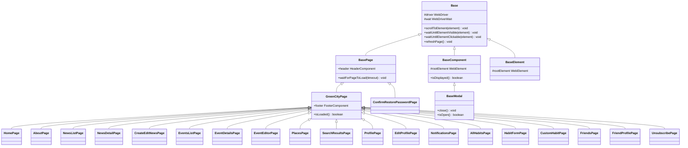

`ConfirmRestorePasswordPage` наслідує `BasePage`, бо на `#/auth/restore` є хедер і немає футера GreenCity. Решта екранів `#/greenCity/**` наслідує `GreenCityPage`.

## Оболонка

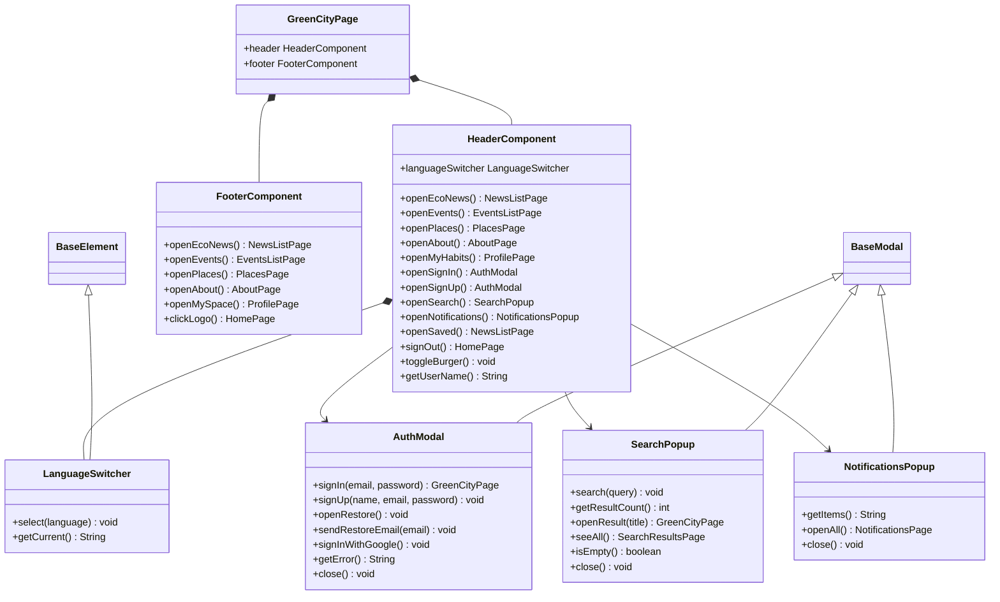

`openSaved()` веде на `NewsListPage` у режимі `isBookmark=true`. Пункт UBS у хедері й футері є на екрані, методу під нього немає.

`AuthModal` перемикає види `sign-in`, `sign-up` і `restore-password` без зміни URL. Підтвердження листа, розблокування і текст помилки — методи цієї ж модалки, не окремі класи. `signIn` повертає сторінку, з якої модалку відкрили.

## Головна, About, відписка

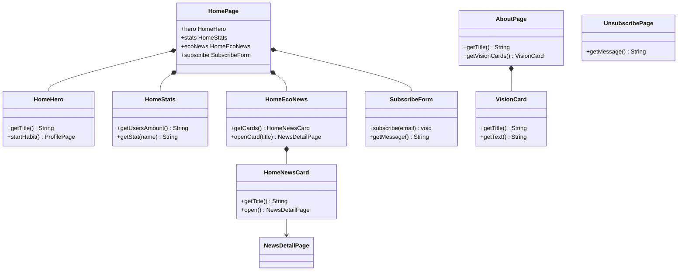

Для гостя `startHabit()` відкриває `AuthModal`, а не профіль. Після входу той самий сценарій потрапляє на `ProfilePage`.

## Новини

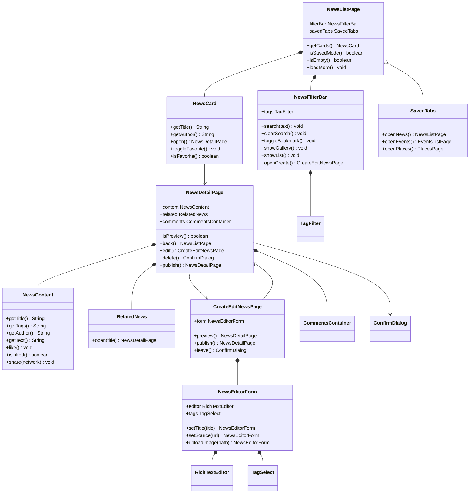

`NewsDetailPage` обслуговує і `#/greenCity/news/:id`, і `#/greenCity/news/preview`. `publish()` існує лише в режимі прев'ю. `SavedTabs` з'являється на списку, коли `isSavedMode()` істинний. Для гостя `openCreate()` відкриває `AuthModal`.

## Події

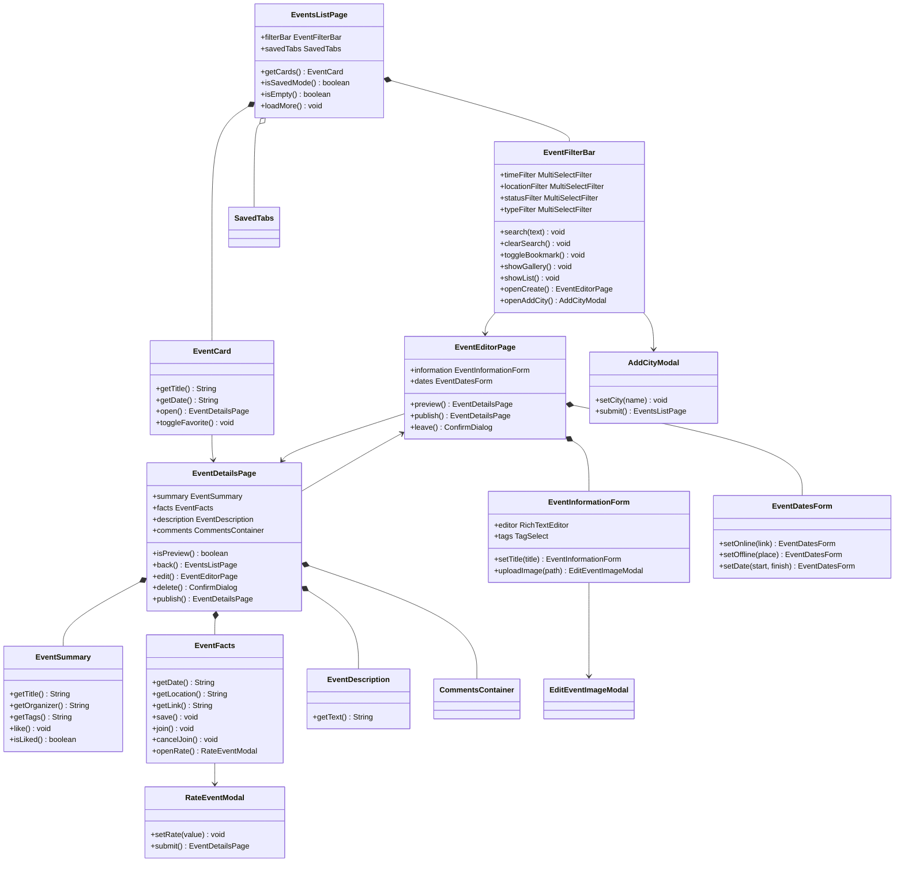

`EventDetailsPage` також покриває `#/greenCity/events/preview`: у прев'ю доступні `publish()` і повернення в редактор, а join і коментарі приховані. Для гостя `openCreate()` і `join()` відкривають `AuthModal`.

## Мапа

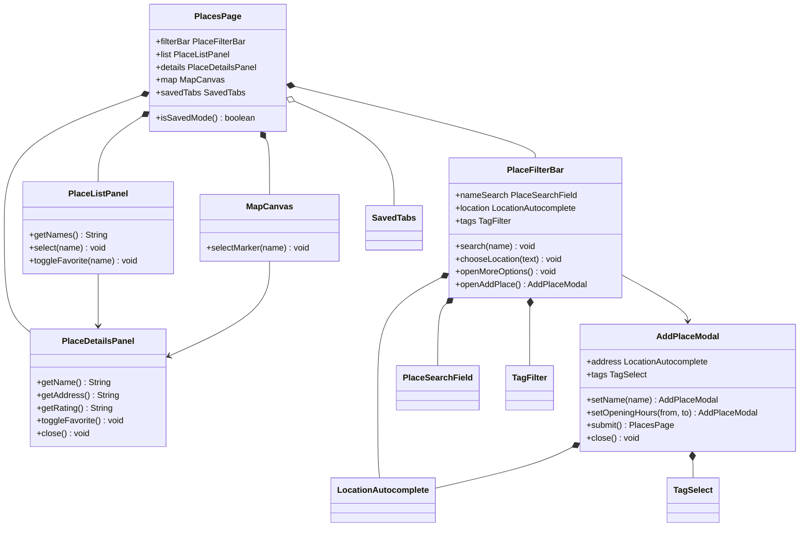

Вибір у списку і клік по маркеру заповнюють один і той самий `PlaceDetailsPanel`. `AddPlaceModal` включає вибір часу роботи, з якого в клієнті починається цей потік.

## Профіль, звички, друзі

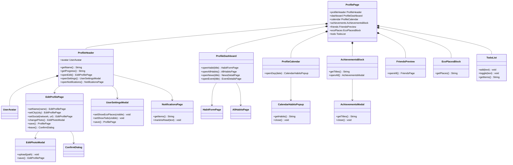

`EcoPlacesBlock` і `TodoList` є на сторінці лише коли користувач увімкнув їх у `UserSettingsModal`.

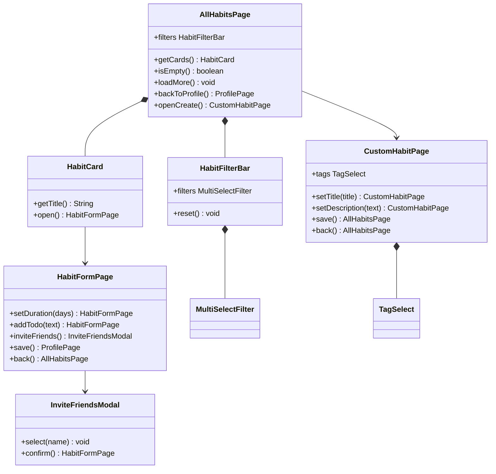

`HabitFormPage` — це і взяття звички з галереї (`addhabit`), і редагування вже призначеної (`edithabit`). `CustomHabitPage` — створення і редагування власної звички.

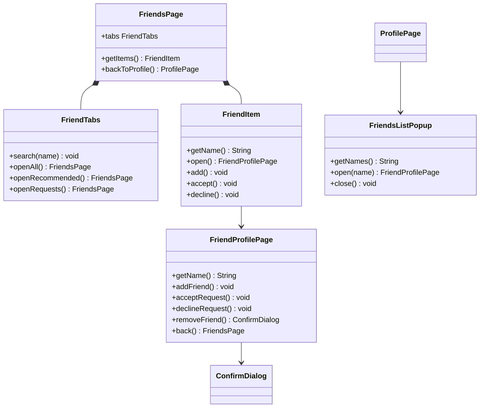

`FriendsPage` одна на три вкладки. `FriendTabs.openAll`, `openRecommended` і `openRequests` лишаються на цьому класі й змінюють вкладку. `FriendsListPopup` відкривається з профілю і не переходить на маршрут друзів.

## Пошук і відновлення пароля

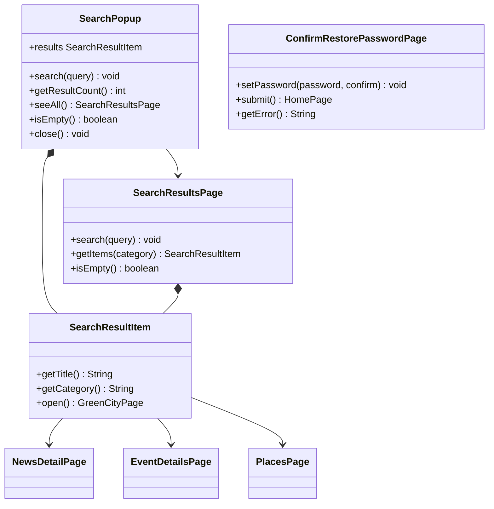

`open()` у результаті повертає сторінку категорії: новину, подію або мапу. `ConfirmRestorePasswordPage` не входить у `GreenCityPage`.

## Спільні віджети

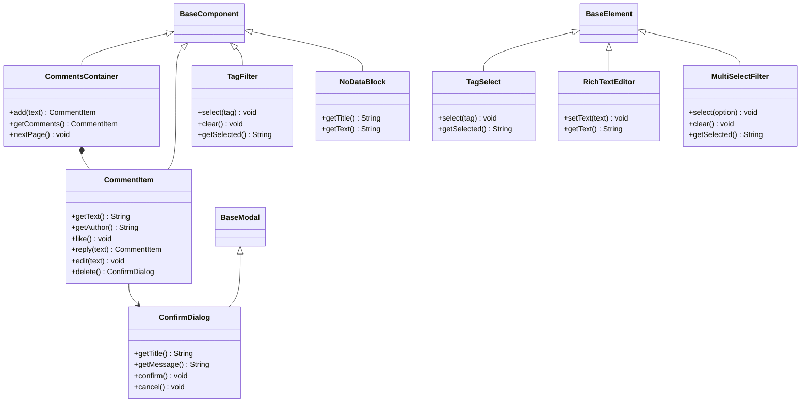

`CommentsContainer` стоїть на `NewsDetailPage` і на `EventDetailsPage`. `ConfirmDialog` один на видалення новини, події, коментаря, друга і на вихід із форми з незбереженими змінами. `NoDataBlock` показують списки новин, подій і звичок, коли видача порожня.

`TagFilter` — фільтр на сторінці списку. `TagSelect` — вибір тегів у формі новини, події, місця і власної звички.
